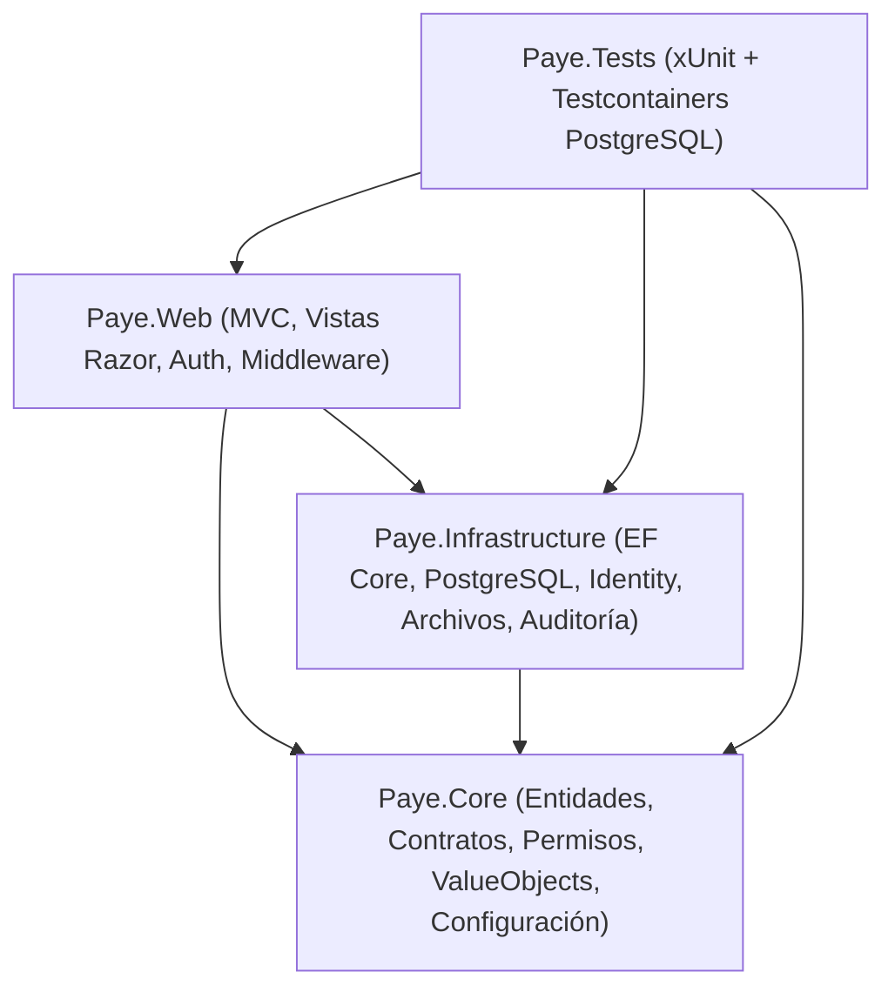

# Arquitectura de Payé Base

**Payé Base** es la plantilla base single-tenant de Payé Digital en **ASP.NET Core MVC (.NET 10 LTS)** y **PostgreSQL**, diseñada para construir aplicaciones de gestión a medida para comercios y pequeñas empresas con bajo coste operativo, alta seguridad por defecto y mantenimiento sencillo.

---

## 1. Principios de Diseño

1. **Single-Tenant por despliegue**: Un contenedor de aplicación y una base de datos PostgreSQL por cliente. Sin complejidad de `TenantId` en tablas ni aislamiento multi-inquilino en código.
2. **Seguridad por defecto (Fail-Closed & Deny-by-Default)**:
   - Si falta una variable crítica al arrancar (`ValidateOnStart`), el servidor detiene el arranque inmediatamente.
   - Toda ruta exige usuario autenticado (`FallbackPolicy`), salvo `[AllowAnonymous]` explícito (`/health`, login y recuperación de contraseña).
3. **Módulos autocontenidos en compilación**: Cada módulo de negocio vive en `Modules/<NombreModulo>/` dentro de `Paye.Core`, `Paye.Infrastructure` y `Paye.Web`. No se usan plugins dinámicos en tiempo de ejecución.
4. **Componentes nativos de Microsoft primero**: Se priorizan las piezas oficiales de ASP.NET Core 10 y EF Core 10, evitando dependencias comerciales o innecesarias (sin MediatR, sin AutoMapper, sin repositorios genéricos, sin Redis, sin Hangfire).

---

## 2. Estructura de la Solución (`Paye.sln`)

### `src/Paye.Core`
- **Responsabilidad**: Modelo de dominio, contratos de servicios, definiciones de permisos (`IPermissionDefinitionProvider`), contratos de navegación (`IModuleNavigationProvider`), objetos de valor (`Money`, `VatRate`), utilidades horarias (`MadridTimeConverter`) y clases de configuración validadas (`DatabaseSettings`, `ClientSettings`, `SecuritySettings`, `SmtpSettings`, `ExternalIntegrationsSettings`).
- **Restricción clave**: No depende de EF Core ni de ASP.NET Core MVC.

### `src/Paye.Infrastructure`
- **Responsabilidad**:
  - `PayeDbContext` (hereda de `IdentityDbContext<ApplicationUser, IdentityRole, string>`).
  - Descubrimiento automático de configuraciones `IEntityTypeConfiguration<T>` (`ApplyConfigurationsFromAssembly`), permitiendo que cada módulo defina sus propias tablas sin acoplar propiedades `DbSet<T>` en `PayeDbContext`.
  - Sellado automático en `SaveChangesAsync` de auditoría (`CreatedAtUtc`, `CreatedBy`, `UpdatedAtUtc`, `UpdatedBy`), borrado lógico (`ISoftDeletable` con filtro global `HasQueryFilter(e => !e.IsDeleted)`) y token de concurrencia optimista nativo de PostgreSQL (`xmin` mapeado a `RowVersion`).
  - Almacenamiento privado de archivos (`LocalPrivateFileStorage`) con verificación de firmas binarias (*magic bytes*).
  - Exportación y anonimización RGPD (`GdprUserDataService`).
  - Siembra idempotente de roles, permisos y primer `Propietario` (`IdentitySeeder`).

### `src/Paye.Web`
- **Responsabilidad**:
  - Composición de dependencias y tubería HTTP en `Program.cs`.
  - Cabeceras de seguridad y CSP estricta sin `unsafe-inline` ni `unsafe-eval` (`SecurityHeadersMiddleware`).
  - Autorización granular mediante `PermissionPolicyProvider` y `PermissionAuthorizationHandler`.
  - Controladores y vistas Razor transversales (`AccountController`, `UsersController`, `AuditController`, `PrivateFilesController`, `HomeController`) y vistas modulares en `/Modules/{Modulo}/Views/{Vista}.cshtml`.
  - Menú lateral dinámico (`SidebarNavigationViewComponent`) filtrado según los permisos del usuario autenticado.

### `tests/Paye.Tests`
- **Responsabilidad**: Pruebas unitarias y de integración reales contra contenedores efímeros de PostgreSQL 17 (`Testcontainers.PostgreSql`), protegidas por `TestDatabaseGuard` para impedir cualquier ejecución accidental contra bases de datos reales.

---

## 3. Flujo Transversal de Datos

- **Fechas y Horas**: Todas las fechas se almacenan en base de datos en **UTC** (`DateTimeOffset` / `timestamptz`). Para mostrarlas o acotarlas por día comercial en España se convierte mediante `MadridTimeConverter` (`Europe/Madrid`).
- **Importes Monetarios e IVA**: Se utiliza siempre `decimal` con precisión `numeric(18,2)` en PostgreSQL y los tipos inmutables `Money` (redondeo bancario `MidpointRounding.ToEven`) y `VatRate` (`21%`, `10%`, `4%`, `0%`). Prohibido usar `float` o `double`.
