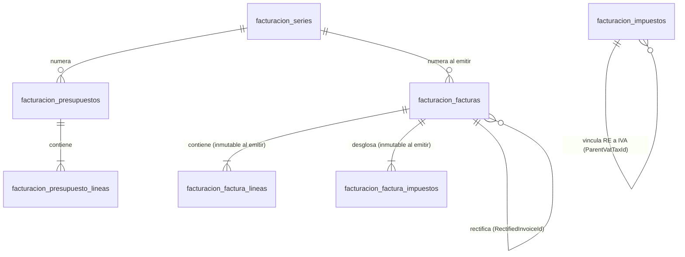

# Guía Técnica Completa de lo Implementado en Payé Base

Este documento explica en detalle **todo lo que está implementado** en el repositorio **Payé Base**: su estructura por capas, cada clase y archivo relevante, el esquema de base de datos en PostgreSQL (incluyendo triggers de inmutabilidad), los flujos de seguridad y permisos, los servicios transversales, el modo Sandbox Demo Aislado, los módulos autocontenidos (`Notas` y `Facturacion`) y el catálogo completo de las **66 pruebas automatizadas**.

---

## 1. Visión General y Mapa de Proyectos

La solución [`Paye.sln`](../Paye.sln) está construida en **.NET 10 LTS** con `TreatWarningsAsErrors=true` y `Nullable=enable` configurados globalmente en [`Directory.Build.props`](../Directory.Build.props).

```mermaid
flowchart LR
    subgraph Web["Paye.Web (Presentación y HTTP)"]
        Program["Program.cs"]
        MW["SecurityHeadersMiddleware"]
        AuthZ["PermissionPolicyProvider\nPermissionAuthorizationHandler"]
        Ctrl["Controllers + Razor Views"]
        ModNotasW["Modules/Notas (Web)"]
        ModFactW["Modules/Facturacion (Web)"]
    end

    subgraph Infra["Paye.Infrastructure (Datos y Servicios)"]
        Db["PayeDbContext\n+ AuditableEntitySaveChangesInterceptor"]
        Id["ApplicationUser + IdentitySeeder"]
        Demo["DemoSandboxService"]
        Audit["DatabaseAuditLogger"]
        Files["LocalPrivateFileStorage"]
        Gdpr["GdprUserDataService"]
        ModNotasI["Modules/Notas (Infra)"]
        ModFactI["Modules/Facturacion (Infra)\n+ PdfInvoiceGenerator"]
    end

    subgraph Core["Paye.Core (Dominio y Contratos)"]
        Ent["AuditableEntity / ISoftDeletable / IConcurrencyTracked"]
        Perm["CorePermissions + RolePermissionCatalog"]
        Fin["Money + VatRate"]
        Inv["Invoicing/IInvoiceIssuer + ITaxCatalogReader"]
        Loc["MadridTimeConverter"]
        Cfg["Settings (ValidateOnStart)"]
        ModNotasC["Modules/Notas (Core)"]
        ModFactC["Modules/Facturacion (Core)\n+ InvoiceTotalsCalculator\n+ SpanishTaxIdValidator"]
    end

    Web --> Infra
    Web --> Core
    Infra --> Core
```

---

## 2. Detalle por Proyecto y Archivo

### 2.1. `src/Paye.Core` (Dominio, Contratos y Reglas Transversales)
No tiene ninguna referencia a EF Core ni a ASP.NET Core MVC.

| Carpeta / Archivo | Qué implementa |
| :--- | :--- |
| `Entities/AuditableEntity.cs` | Clase base con `CreatedAtUtc`, `CreatedBy`, `UpdatedAtUtc`, `UpdatedBy` y `RowVersion` (`uint` mapeado a `xmin` de PostgreSQL), además de las interfaces `ISoftDeletable` (`IsDeleted`, `DeletedAtUtc`, `DeletedBy`) e `IConcurrencyTracked`. |
| `Entities/AuditLogEntry.cs` | Entidad inmutable de registro de auditoría crítica (`Id`, `OccurredAtUtc`, `ActorId`, `ActorEmail`, `Action`, `EntityName`, `EntityId`, `Summary`, `IpAddress`). |
| `Auditing/IAuditLogger.cs` | Contrato `LogCriticalActionAsync` / `LogAsync` para registrar acciones críticas de negocio o seguridad sin datos sensibles. |
| `Authorization/CorePermissions.cs` | Constantes de permisos del núcleo (`Usuarios.Ver/Crear/Editar`, `Roles.Gestionar`, `Auditoria.Ver`, `Archivos.Subir/Descargar`), catálogo de roles base (`Propietario`, `Encargado`, `Empleado`) y contrato `IPermissionDefinitionProvider` para que cada módulo declare sus propios permisos. |
| `Common/ICurrentUserService.cs` | Contrato para conocer el usuario autenticado en la petición actual (`UserId`, `Email`, `IpAddress`, `IsAuthenticated`, `IsDemoSandboxUser`, `GetActorIdentifier()`). |
| `Configuration/*.cs` | Clases de opciones fuertemente tipadas con validación al arrancar (`ValidateOnStart`): `DatabaseSettings`, `ClientSettings`, `SecuritySettings`, `SmtpSettings`, `ExternalIntegrationsSettings` y `DemoSandboxSettings`. |
| `Demo/IDemoSandboxService.cs` | Constantes `DemoSandboxConstants` (`demo-<guid>`), contrato modular `IDemoModuleDataProvider` y servicio `IDemoSandboxService` para sesiones efímeras de demostración. |
| `Email/IEmailSender.cs` | Contrato de envío de correo con `IsConfigured` explícito (nunca simula envíos si SMTP está desactivado). |
| `Files/PrivateFileContracts.cs` | Entidad `PrivateFileRecord`, comando de subida y contrato `IPrivateFileStorage` para archivos privados fuera de `wwwroot`. |
| `ValueObjects/Money.cs` y `VatRate.cs` | `readonly record struct Money` en `decimal` con redondeo centralizado en `Money.DefaultRoundingMode` (`MidpointRounding.ToEven`) y `Money.Round(decimal, int)`, y `VatRate` con los tipos de IVA de España (`21%`, `10%`, `4%`, `0%`). |
| `Invoicing/IInvoiceIssuer.cs` | Contratos transversales `IInvoiceIssuer` e `ITaxCatalogReader` junto con `TaxKind`, `TaxApplicability`, `InvoiceDocumentType`, `BillingPaymentMethod`, `RectificationScope` y DTOs para que futuros módulos (como `Pos`) consulten impuestos y emitan facturas sin depender de `Facturacion`. |
| `Gdpr/IGdprUserDataService.cs` | Contratos para exportación JSON de datos de un usuario (`ExportUserDataAsync`) y anonimización irreversible (`AnonymizeUserAsync`). |
| `Integrations/IExternalIntegrationStatusProvider.cs` | Contrato preparado para consultar si integraciones opcionales por entorno están configuradas o desactivadas. |
| `Localization/MadridTimeConverter.cs` | Conversión bidireccional entre `UTC` y la zona horaria `Europe/Madrid` (invierno CET +01:00 / verano CEST +02:00) y cálculo de inicio/fin de jornada comercial. |
| `Navigation/IModuleNavigationProvider.cs` | Contrato por el que cada módulo aporta sus elementos al menú lateral indicando `RequiredPermission` y orden. |
| `Modules/Notas/*` | Entidad `Nota` (`AuditableEntity, ISoftDeletable`), permisos `NotasPermissions` (`Notas.Ver/Crear/Editar/Borrar`) y contratos `INotasService`. |
| `Modules/Facturacion/*` | Entidades (`BillingSettings`, `TaxRateDefinition`, `BillingSeries`, `Quote`, `QuoteLine`, `Invoice`, `InvoiceLine`, `InvoiceTaxBreakdown`), `FacturacionPermissions` (`Facturacion.Ver/Crear/Emitir/Rectificar/Descargar/Configurar`), `InvoiceTotalsCalculator` (cálculo de IVA, Recargo de Equivalencia e IRPF), `SpanishTaxIdValidator` (validación de NIF/NIE/CIF), `IFiscalInvoiceRegistry` (punto de extensión VERI*FACTU / NO VERI*FACTU) y `FacturacionContracts` (`IFacturacionService`, `IPdfInvoiceGenerator`). |

---

### 2.2. `src/Paye.Infrastructure` (Persistencia PostgreSQL, Identity y Servicios)

| Carpeta / Archivo | Qué implementa |
| :--- | :--- |
| `Data/PayeDbContext.cs` | Hereda de `IdentityDbContext<ApplicationUser, IdentityRole, string>`. Configura `audit_logs` y `private_files`, descubre automáticamente configuraciones de módulos con `ApplyConfigurationsFromAssembly`, activa `IsRowVersion()` (`xmin`) en todo `IConcurrencyTracked` y aplica el filtro global `!e.IsDeleted` en todo `ISoftDeletable`. |
| `Data/Interceptors/AuditableEntitySaveChangesInterceptor.cs` | Interceptor de EF Core que en cada `SaveChanges` rellena automáticamente `CreatedAtUtc`/`CreatedBy` y `UpdatedAtUtc`/`UpdatedBy`, e intercepta `EntityState.Deleted` en entidades `ISoftDeletable` para convertirlo en borrado lógico (`IsDeleted = true`). |
| `Identity/ApplicationUser.cs` | Extiende `IdentityUser` con `FullName`, `IsActive` y `CreatedAtUtc`. |
| `Identity/IdentitySeeder.cs` | Crea de forma idempotente los roles (`Propietario`, `Encargado`, `Empleado`), sincroniza los claims `paye.permission` descubiertos de todos los `IPermissionDefinitionProvider` y siembra el primer `Propietario` desde variables de entorno (`SEED_OWNER_*`). |
| `Demo/DemoSandboxService.cs` | Crea sesiones efímeras `demo-<guid>` con contraseña aleatoria descartable, asigna solo permisos permitidos en Demo, invoca a los `IDemoModuleDataProvider` para sembrar datos de ejemplo y purga todos los datos y la cuenta al cerrar sesión (o tras 2 horas de expiración). |
| `Auditing/DatabaseAuditLogger.cs` | Persiste entradas en la tabla `audit_logs` rellenando automáticamente el actor y la IP desde `ICurrentUserService`. |
| `Files/LocalPrivateFileStorage.cs` | Valida tamaño máximo, extensión y **firmas binarias reales (*magic bytes*)** para PDF (`%PDF-`), PNG, JPEG y WEBP. Guarda el archivo en disco fuera de `wwwroot` con nombre `Guid` y registra sus metadatos en `private_files`. |
| `Gdpr/GdprUserDataService.cs` | Genera el paquete JSON de portabilidad RGPD y anonimiza cuentas inactivas reemplazando PII por hashes irreemplazables e invalidando credenciales. |
| `Email/SmtpEmailSender.cs` | Envía correos reales por `SmtpClient` cuando `Smtp:Enabled = true`; si `false`, lanza `InvalidOperationException` explícita y nunca finge el envío. |
| `Modules/Notas/*` | `NotaEntityConfiguration` (tabla `module_notas`), `NotasService` y `NotasDemoDataProvider`. |
| `Modules/Facturacion/*` | `FacturacionEntityConfigurations` (8 tablas de facturación), `FacturacionService` (presupuestos, borradores, numeración correlativa atómica con `UPDATE ... RETURNING`, rectificativas con `SELECT ... FOR UPDATE`, catálogo de impuestos e implementación de `IInvoiceIssuer` e `ITaxCatalogReader`), `PdfInvoiceGenerator` (generador PDF 1.4 nativo con validación de logo JPEG/PNG 8-bit RGB), `NoOpFiscalInvoiceRegistry` y `FacturacionDemoDataProvider`. |

---

### 2.3. `src/Paye.Web` (Tubería HTTP, Autorización, Controladores y Vistas Razor)

| Carpeta / Archivo | Qué implementa |
| :--- | :--- |
| `Program.cs` | Punto de entrada. Soporta los comandos CLI `--healthcheck` y `--migrate`. Configura `ValidateOnStart`, `DataProtection`, `ForwardedHeaders`, `Identity`, `SecurityStampValidator` (`TimeSpan.Zero`), cookies (`__Host-Paye.Auth` y `__Host-Paye.Antiforgery` en Producción), `FallbackPolicy` (Deny-by-Default), `RateLimiter` (`auth-strict` en login), localización `es-ES`, compresión y registro de módulos (`AddNotasModule()`, `AddFacturacionModule()`). |
| `Middleware/SecurityHeadersMiddleware.cs` | Inyecta en cada respuesta `Content-Security-Policy` estricta (sin `unsafe-inline` ni `unsafe-eval`), `Strict-Transport-Security`, `X-Content-Type-Options: nosniff`, `X-Frame-Options: DENY`, `Referrer-Policy` y `Permissions-Policy`. |
| `Authorization/PermissionPolicyProvider.cs` y `PermissionAuthorizationHandler.cs` | Resuelven políticas `[Authorize(Policy = "...")]` verificando el claim `paye.permission` del usuario y bloqueando permisos administrativos a cuentas `demo-*`. |
| `Controllers/AccountController.cs` | Login con contraseña, entrada en Sandbox Demo (`POST /account/demo-login`), segundo factor 2FA TOTP, cambio de contraseña, recuperación por correo y cierre de sesión con limpieza automática de demo. |
| `Controllers/UsersController.cs` | Gestión administrativa de usuarios (`/admin/users`), matriz de permisos, protección del último `Propietario` y acciones RGPD. |
| `Controllers/AuditController.cs` | Visor paginado y filtrable de registros de auditoría (`/admin/audit`). |
| `Controllers/PrivateFilesController.cs` | Gestión y descarga autenticada de archivos privados (`/files`), bloqueada para sesiones `demo-*`. |
| `ViewComponents/SidebarNavigationViewComponent.cs` | Construye el menú lateral filtrando dinámicamente los enlaces de administración y de módulos según los permisos del usuario actual. |
| `Modules/Notas/*` | `NotasController`, `NotasViewModels`, `NotasNavigationProvider`, `NotasModuleExtensions` y vistas Razor en `Modules/Notas/Views/`. |
| `Modules/Facturacion/*` | `FacturacionController` (26 rutas para presupuestos, borradores, emisión, rectificativas, PDF y configuración de emisor/logo/series/impuestos), `FacturacionViewModels`, `FacturacionNavigationProvider`, `FacturacionModuleExtensions` y 7 vistas Razor en `Modules/Facturacion/Views/`. |
| `wwwroot/css/theme.css` y `site.css` | Sistema de diseño limpio con variables CSS personalizables por cliente y cero estilos inline. |

---

## 3. Esquema de Base de Datos (PostgreSQL)

Compuesto por dos migraciones aditivas:
1. [`20261022130306_InitialBaselineAndNotas.cs`](../src/Paye.Infrastructure/Data/Migrations/20261022130306_InitialBaselineAndNotas.cs): Tablas de `ASP.NET Core Identity`, `audit_logs`, `private_files` y `module_notas`.
2. [`20261026205500_AddFacturacionModule.cs`](../src/Paye.Infrastructure/Data/Migrations/20261026205500_AddFacturacionModule.cs): Tablas del módulo `Facturacion` (`facturacion_config`, `facturacion_impuestos`, `facturacion_series`, `facturacion_presupuestos`, `facturacion_presupuesto_lineas`, `facturacion_facturas`, `facturacion_factura_lineas`, `facturacion_factura_impuestos`), semilla del catálogo fiscal español y **3 triggers PL/pgSQL (`ERRCODE = '55000'`)** que impiden `UPDATE`/`DELETE` sobre facturas emitidas y `INSERT`/`UPDATE`/`DELETE` sobre líneas y desglose de impuestos de facturas emitidas.

---

## 4. Mapa Completo de Rutas HTTP y Permisos

### 4.1. Rutas del Núcleo y Módulo `Notas`

| Método y Ruta | Controlador | Acceso / Permiso Exigido | Descripción |
| :--- | :--- | :--- | :--- |
| `GET /health` | `Program.cs` | `[AllowAnonymous]` | Healthcheck JSON (`200 OK` si PostgreSQL responde, `503` si falla). |
| `GET/POST /account/login` | `AccountController` | `[AllowAnonymous]` + RateLimit | Inicio de sesión con correo/contraseña. |
| `POST /account/demo-login` | `AccountController` | `[AllowAnonymous]` + RateLimit | Inicia sesión efímera `demo-<guid>` (`404` si `DemoSandbox:Enabled=false`). |
| `GET/POST /account/login-2fa` | `AccountController` | `[AllowAnonymous]` + RateLimit | Verificación de código TOTP de segundo factor. |
| `POST /account/logout` | `AccountController` | Autenticado | Cierra sesión (y si es cuenta `demo-*`, elimina todos sus datos y usuario). |
| `GET/POST /account/change-password` | `AccountController` | Autenticado (no Demo) | Cambio de contraseña con regeneración de `SecurityStamp`. |
| `GET/POST /account/two-factor` | `AccountController` | Autenticado (no Demo) | Activación/desactivación de 2FA TOTP. |
| `GET/POST /account/forgot-password` | `AccountController` | `[AllowAnonymous]` | Solicitud de recuperación por SMTP. |
| `GET/POST /account/reset-password` | `AccountController` | `[AllowAnonymous]` | Restablecimiento de contraseña mediante token firmado. |
| `GET /` | `HomeController` | Autenticado | Panel principal. |
| `GET/POST /admin/users/*` | `UsersController` | `Usuarios.Ver/Crear/Editar`, `Roles.Gestionar` | Administración de usuarios, permisos de roles y acciones RGPD. |
| `GET /admin/audit` | `AuditController` | `Auditoria.Ver` | Historial paginado de auditoría. |
| `GET/POST /files/*` | `PrivateFilesController` | `Archivos.Descargar/Subir` (no Demo) | Almacenamiento y descarga de archivos privados fuera de `wwwroot`. |
| `GET/POST /notas/*` | `NotasController` | `Notas.Ver/Crear/Editar/Borrar` | CRUD completo de notas con archivado, borrado lógico y concurrencia `xmin`. |

### 4.2. Rutas del Módulo `Facturacion`

| Método y Ruta | Controlador | Permiso Exigido | Descripción |
| :--- | :--- | :--- | :--- |
| `GET /facturacion` | `FacturacionController` | `Facturacion.Ver` | Panel de facturas y presupuestos con filtros por pestaña y estado. |
| `GET/POST /facturacion/presupuestos/crear` | `FacturacionController` | `Facturacion.Crear` | Creación de presupuesto numerado en serie no fiscal. |
| `GET /facturacion/presupuestos/{id:guid}` | `FacturacionController` | `Facturacion.Ver` | Detalle de presupuesto, estado y acciones de transición. |
| `GET/POST /facturacion/presupuestos/{id:guid}/editar` | `FacturacionController` | `Facturacion.Crear` | Edición de presupuesto en estado `Borrador` o `Enviado`. |
| `POST /facturacion/presupuestos/{id:guid}/estado` | `FacturacionController` | `Facturacion.Crear` | Transición de estado (`Enviado`, `Aceptado`, `Rechazado`, `Caducado`). |
| `POST /facturacion/presupuestos/{id:guid}/convertir` | `FacturacionController` | `Facturacion.Crear` | Convierte un presupuesto `Aceptado` en borrador de factura. |
| `GET /facturacion/presupuestos/{id:guid}/pdf` | `FacturacionController` | `Facturacion.Descargar` | Descarga PDF 1.4 del presupuesto y registra auditoría en `audit_logs`. |
| `GET/POST /facturacion/facturas/crear` | `FacturacionController` | `Facturacion.Crear` | Creación de borrador de factura (sin consumir numeración fiscal). |
| `GET /facturacion/facturas/{id:guid}` | `FacturacionController` | `Facturacion.Ver` | Detalle de borrador o factura emitida, desglose fiscal y rectificativas asociadas. |
| `GET/POST /facturacion/facturas/{id:guid}/editar` | `FacturacionController` | `Facturacion.Crear` | Edición de borrador de factura (bloqueado si ya está `Emitida`). |
| `POST /facturacion/facturas/{id:guid}/eliminar` | `FacturacionController` | `Facturacion.Crear` | Eliminación de borrador de factura (bloqueado si ya está `Emitida`). |
| `POST /facturacion/facturas/{id:guid}/emitir` | `FacturacionController` | `Facturacion.Emitir` (no Demo) | Emisión definitiva con numeración correlativa atómica (`UPDATE ... RETURNING`). |
| `GET /facturacion/facturas/{id:guid}/pdf` | `FacturacionController` | `Facturacion.Descargar` | Descarga PDF 1.4 de la factura y registra auditoría en `audit_logs`. |
| `GET/POST /facturacion/facturas/{id:guid}/rectificar` | `FacturacionController` | `Facturacion.Rectificar` (no Demo) | Emisión de factura rectificativa (total o parcial por diferencias). |
| `GET /facturacion/configuracion` | `FacturacionController` | `Facturacion.Configurar` (no Demo) | Ajustes de datos fiscales del emisor, logotipo, series y catálogo de impuestos. |
| `POST /facturacion/configuracion/emisor` | `FacturacionController` | `Facturacion.Configurar` (no Demo) | Guarda razón social, NIF/CIF validado, domicilio fiscal, textos legales y pie. |
| `POST /facturacion/configuracion/logo` | `FacturacionController` | `Facturacion.Configurar` (no Demo) | Subida privada o eliminación del logotipo (solo JPEG o PNG RGB sin alfa). |
| `POST /facturacion/configuracion/series` | `FacturacionController` | `Facturacion.Configurar` (no Demo) | Alta o edición de series por tipo de documento y ejercicio. |
| `POST /facturacion/configuracion/impuestos/crear` | `FacturacionController` | `Facturacion.Configurar` (no Demo) | Alta de tipo de impuesto (`IVA`, `RecargoEquivalencia`, `IRPF`). |
| `POST /facturacion/configuracion/impuestos/actualizar` | `FacturacionController` | `Facturacion.Configurar` (no Demo) | Edición de impuesto existente (nombre, %, ámbito B2B/B2C/Ambos). |
| `POST /facturacion/configuracion/impuestos/estado` | `FacturacionController` | `Facturacion.Configurar` (no Demo) | Activación o desactivación de un impuesto (nunca borrado físico). |

---

## 5. Batería de Pruebas Automatizadas (`66/66` en `tests/Paye.Tests`)

> [!NOTE]
> `dotnet test Paye.sln` ejecuta **66 casos de prueba** (48 métodos `[Fact]`/`[Theory]`, donde los `[Theory]` con múltiples `[InlineData]` se expanden a casos individuales en `dotnet test --list-tests`). Todos los tests de base de datos e integración corren contra contenedores reales **PostgreSQL 17** (`Testcontainers.PostgreSql`) validados por `TestDatabaseGuard`.

| Suite de Pruebas | Métodos (`[Fact]`/`[Theory]`) | Casos Ejecutados (`dotnet test`) | Qué verifica |
| :--- | :---: | :---: | :--- |
| [`BaselineSecurityAndHealthTests.cs`](../tests/Paye.Tests/Milestone1/BaselineSecurityAndHealthTests.cs) | 8 | **11** | Deny-by-default, `/health`, cabeceras CSP/HSTS/nosniff/DENY, CORS estricto, Antiforgery y arranque *Fail-Closed* (con 5 combinaciones de configuración inválida). |
| [`IdentityAndAuthorizationTests.cs`](../tests/Paye.Tests/Milestone2/IdentityAndAuthorizationTests.cs) | 8 | **8** | Siembra idempotente del primer `Propietario`, login + cookie `__Host-`, bloqueo tras 5 fallos, permisos por claims, invalidación inmediata de sesión al desactivar usuario, protección del último `Propietario`, aviso explícito con SMTP desactivado y 2FA TOTP. |
| [`CrossCuttingFeaturesTests.cs`](../tests/Paye.Tests/Milestone3a/CrossCuttingFeaturesTests.cs) | 7 | **7** | `Money` y `VatRate`, `MadridTimeConverter` (CET/CEST), auditoría automática, soft-delete, concurrencia `xmin`, subida privada con validación de *magic bytes* y exportación/anonimización RGPD. |
| [`NotasModuleIntegrationTests.cs`](../tests/Paye.Tests/Milestone3b/NotasModuleIntegrationTests.cs) | 5 | **5** | CRUD completo de `Notas`, conflicto de concurrencia `xmin` en UI, autorización por permiso `Notas.Borrar` y cumplimiento de CSP sin estilos inline. |
| [`AcceptanceAndOperationsTests.cs`](../tests/Paye.Tests/Milestone4/AcceptanceAndOperationsTests.cs) | 4 | **4** | Desacoplamiento modular por reflexión, configuración por variables de entorno, backup/restore real con `pg_dump` + `psql` y ciclo completo del **Sandbox Demo Aislado**. |
| [`FacturacionPaso1DomainAndTriggersTests.cs`](../tests/Paye.Tests/Facturacion/FacturacionPaso1DomainAndTriggersTests.cs) | 4 | **16** | 13 casos de `SpanishTaxIdValidator` (NIF/NIE/CIF), cuadre de `InvoiceTotalsCalculator` solo con `LineNet`, cálculo de IVA + RE + IRPF AEAT y rechazo por triggers PostgreSQL (`SQLSTATE 55000`) de `UPDATE`/`DELETE` en facturas emitidas, líneas y desglose fiscal. |
| [`FacturacionPaso2ServiceAndConcurrencyTests.cs`](../tests/Paye.Tests/Facturacion/FacturacionPaso2ServiceAndConcurrencyTests.cs) | 10 | **10** | Numeración correlativa atómica sin huecos tras rollback, emisiones concurrentes sin duplicar número, rectificaciones concurrentes con `FOR UPDATE`, rectificativas total y por diferencias sin alterar original, presupuestos en serie no fiscal, catálogo de impuestos configurable, bloqueo Demo, generador PDF 1.4 + logo + auditoría y aislamiento `Facturacion` $\not\rightarrow$ `Pos`. |
| [`FacturacionPaso3WebAndModularityTests.cs`](../tests/Paye.Tests/Facturacion/FacturacionPaso3WebAndModularityTests.cs) | 5 | **5** | Aislamiento arquitectónico de `Facturacion`, arranque de la app sin el módulo, seguridad HTTP Web + CSP estricta en las 7 vistas, flujo Web completo (emisor $\rightarrow$ presupuesto $\rightarrow$ aceptar $\rightarrow$ convertir $\rightarrow$ emitir $\rightarrow$ PDF $\rightarrow$ rectificar) y Sandbox Demo Web con borrado al cerrar sesión. |
| **TOTAL** | **51** | **66** | **66 pasados, 0 fallidos, 0 omitidos** |
