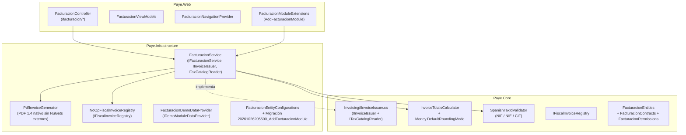

# Módulo `Facturacion` — Diseño Técnico, Reglas Fiscales e Implementación

Este documento detalla la arquitectura y funcionamiento completo del módulo autocontenido **`Facturacion`**, diseñado bajo el patrón modular de **Payé Base** (`src/Paye.Core/Modules/Facturacion`, `src/Paye.Infrastructure/Modules/Facturacion`, `src/Paye.Web/Modules/Facturacion`) junto con los contratos transversales en `src/Paye.Core/Invoicing` preparados para el futuro módulo `Pos`.

---

## 1. Principios de Diseño y Reglas Innegociables

1. **Inmutabilidad absoluta de facturas emitidas**:
   - Cuando una factura pasa a `Status = 'Emitida'`, ni la cabecera (`facturacion_facturas`), ni sus líneas (`facturacion_factura_lineas`), ni su desglose fiscal (`facturacion_factura_impuestos`) pueden modificarse ni borrarse.
   - Protegido en PostgreSQL mediante **3 triggers `BEFORE` con `ERRCODE = '55000'`** (`object_not_in_prerequisite_state`), sin excepciones ni siquiera para sesiones Demo.
2. **Rectificación como único mecanismo de corrección**:
   - Una factura emitida solo se corrige emitiendo una **Factura Rectificativa** (`InvoiceDocumentType.Rectificativa`), que es un nuevo registro inmutable con serie propia (`R`) enlazado a la factura original mediante `RectifiedInvoiceId`.
   - Soporta rectificación **Total** (invierte signo de líneas, bases y cuotas; impide rectificaciones posteriores) y **Parcial por diferencias** (valida que la suma acumulada rectificada no supere el importe original).
   - Bloquea la fila de la factura original con `SELECT "Id" FROM facturacion_facturas WHERE "Id" = {0} FOR UPDATE` dentro de la transacción de emisión para impedir rectificaciones concurrentes contradictorias.
3. **Numeración correlativa atómica sin huecos por serie y ejercicio**:
   - Los presupuestos se numeran al crearse sobre una serie no fiscal (`BillingDocumentKind.Presupuesto`, p. ej. `P-2026-0001`).
   - Los borradores de factura (`Status = 'Borrador'`) **no tienen número asignado** (`SequentialNumber = NULL`, `FormattedNumber = NULL`).
   - El número correlativo fiscal se asigna **únicamente en el instante de emitir** dentro de la misma transacción de base de datos mediante `UPDATE facturacion_series SET "LastNumber" = "LastNumber" + 1 ... RETURNING "LastNumber", "Code", "FiscalYear", "PaddingDigits"`. Si cualquier paso posterior falla, el `ROLLBACK` devuelve el contador a su valor anterior sin dejar huecos.
4. **Cálculo fiscal y redondeo aislados en un único punto**:
   - Todo cálculo de líneas, bases imponibles por tipo, cuotas de IVA, Recargo de Equivalencia y retención de IRPF se ejecuta en [`InvoiceTotalsCalculator`](../src/Paye.Core/Modules/Facturacion/InvoiceTotalsCalculator.cs), que delega el redondeo exclusivamente en [`Money.Round`](../src/Paye.Core/ValueObjects/Money.cs#L15-L21) (`MidpointRounding.ToEven` aislado en la constante `Money.DefaultRoundingMode`).
   - En las líneas (`QuoteLine` / `InvoiceLine`) **solo se persiste `LineNet`** (importe neto de línea redondeado a 2 decimales). Las cuotas de IVA y Recargo de Equivalencia se calculan y persisten **por grupo impositivo agregado** en `facturacion_factura_impuestos` (`InvoiceTaxBreakdown`), garantizando que `SubtotalNet + TotalTax - TotalWithholding == TotalPayable` siempre cuadre al céntimo sin descuadres de suma de líneas.
5. **Desacoplamiento modular (`Facturacion` $\not\rightarrow$ `Pos`)**:
   - `Facturacion` no tiene ninguna referencia a `Pos`.
   - Expone en `Paye.Core.Invoicing` los contratos [`IInvoiceIssuer`](../src/Paye.Core/Invoicing/IInvoiceIssuer.cs#L112-L124) e [`ITaxCatalogReader`](../src/Paye.Core/Invoicing/IInvoiceIssuer.cs#L126-L133) para que `Pos` pueda consultar impuestos y emitir facturas simplificadas/ordinarias sin acoplarse a la implementación interna de `Facturacion`.
   - El registro fiscal (`VERI*FACTU` / `NO VERI*FACTU`) queda abstraído detrás de [`IFiscalInvoiceRegistry`](../src/Paye.Core/Modules/Facturacion/IFiscalInvoiceRegistry.cs) con implementación por defecto [`NoOpFiscalInvoiceRegistry`](../src/Paye.Infrastructure/Modules/Facturacion/NoOpFiscalInvoiceRegistry.cs).

---

## 2. Diagrama de Dependencias y Contratos

---

## 3. Modelo de Datos y Esquema PostgreSQL

Definido en [`FacturacionEntities.cs`](../src/Paye.Core/Modules/Facturacion/FacturacionEntities.cs), configurado en [`FacturacionEntityConfigurations.cs`](../src/Paye.Infrastructure/Modules/Facturacion/FacturacionEntityConfigurations.cs) y materializado en la migración [`20261026205500_AddFacturacionModule.cs`](../src/Paye.Infrastructure/Data/Migrations/20261026205500_AddFacturacionModule.cs):

| Tabla PostgreSQL | Entidad C# | Propósito y Restricciones Clave |
| :--- | :--- | :--- |
| `facturacion_config` | `BillingSettings` | Datos fiscales del emisor (`TaxName`, `TaxId`, `FiscalAddress`), textos legales (`LegalTermsText`), pie (`FooterText`), retención IRPF por defecto y referencia al logotipo privado (`LogoPrivateFileId`). |
| `facturacion_impuestos` | `TaxRateDefinition` | Catálogo configurable de impuestos (`Iva`, `RecargoEquivalencia`, `Irpf`), ámbito (`Ambos`, `B2B`, `B2C`), vínculo `ParentVatTaxId` para recargos, códigos AEAT (`AeatTaxCode`, `AeatRegimeKey`, `AeatOperationQualification`) y flag `IsActive` (se desactivan, nunca se borran). Semilla inicial: IVA 21%, 10%, 4%, 0%; RE 5,20%, 1,40%, 0,50%; IRPF 15%, 7%. |
| `facturacion_series` | `BillingSeries` | Series por tipo de documento (`Presupuesto`, `Ordinaria`, `Simplificada`, `Rectificativa`) y ejercicio fiscal (`FiscalYear` calculado en `Europe/Madrid`). Índice único `IX_facturacion_series_Code_FiscalYear` y contador atómico `LastNumber`. |
| `facturacion_presupuestos` | `Quote` | Presupuestos numerados en serie no fiscal con estados `Borrador`, `Enviado`, `Aceptado`, `Rechazado`, `Caducado` y referencia `ConvertedInvoiceId` cuando se convierten en borrador de factura. |
| `facturacion_presupuesto_lineas` | `QuoteLine` | Líneas de presupuesto con snapshot del impuesto aplicado y `LineNet`. |
| `facturacion_facturas` | `Invoice` | Cabecera de facturas en `Borrador` o `Emitida`. Índice único filtrado `(SeriesId, FiscalYear, SequentialNumber) WHERE SequentialNumber IS NOT NULL`. Incluye snapshot inmutable de emisor y cliente, totales y vínculo `RectifiedInvoiceId`. |
| `facturacion_factura_lineas` | `InvoiceLine` | Líneas de factura con `LineOrder`, `Description`, `Quantity`, `UnitPriceNet`, snapshot de IVA/Recargo y `LineNet`. |
| `facturacion_factura_impuestos` | `InvoiceTaxBreakdown` | Snapshot de desglose fiscal por tipo impositivo (`TaxKind`, `TaxName`, `TaxPercentage`, `SurchargePercentage`, códigos AEAT, `TaxableBase`, `TaxAmount`, `SurchargeAmount`). |

### Triggers de Inmutabilidad en PostgreSQL
La migración crea tres funciones PL/pgSQL y tres triggers con `ERRCODE = '55000'`:
1. `trg_facturacion_facturas_immutable` (`BEFORE UPDATE OR DELETE ON facturacion_facturas`): bloquea cualquier `UPDATE` o `DELETE` cuando `OLD."Status" = 'Emitida'`.
2. `trg_facturacion_factura_lineas_immutable` (`BEFORE INSERT OR UPDATE OR DELETE ON facturacion_factura_lineas`): consulta el estado de la factura padre y bloquea inserciones, modificaciones o borrados si la factura está `Emitida`.
3. `trg_facturacion_factura_impuestos_immutable` (`BEFORE INSERT OR UPDATE OR DELETE ON facturacion_factura_impuestos`): bloquea cualquier alteración del desglose fiscal de una factura `Emitida`.

---

## 4. Máquina de Estados y Transiciones Permitidas

### 4.1. Presupuestos (`QuoteStatus`)
- Al crearse nacen en `Borrador` con número asignado de su serie no fiscal (`P-YYYY-NNNN`).
- Mientras están en `Borrador` o `Enviado` pueden editarse sus líneas y datos de cliente.
- Transiciones de estado válidas:
  - `Borrador` $\rightarrow$ `Enviado`, `Aceptado`, `Rechazado`, `Caducado`
  - `Enviado` $\rightarrow$ `Aceptado`, `Rechazado`, `Caducado`
- **Conversión a borrador de factura**: solo permitida desde `Aceptado` y una única vez (`ConvertedInvoiceId == null`). Crea un `Invoice` en estado `Borrador` copiando cliente, líneas e impuestos sin consumir numeración fiscal de facturas.

### 4.2. Facturas (`InvoiceStatus`)
- **`Borrador`**: editable y eliminable físicamente; `SequentialNumber` y `FormattedNumber` son `NULL`.
- **Emisión (`Borrador` $\rightarrow$ `Emitida`)**:
  1. Verifica que no sea un usuario de Sandbox Demo (`ForbiddenInDemo`).
  2. Verifica que la configuración del emisor (`TaxName`, `TaxId` válido por `SpanishTaxIdValidator`, `FiscalAddress`) esté completa.
  3. Si es `Ordinaria` o `Rectificativa`, exige `CustomerName`, `CustomerTaxId` válido y `CustomerAddress`.
  4. Recalcula totales y desglose con `InvoiceTotalsCalculator`.
  5. En transacción, incrementa atómicamente `facturacion_series` con `UPDATE ... RETURNING`, sella `SequentialNumber`, `FormattedNumber`, `IssuedAtUtc`, snapshot del emisor y `Status = Emitida`, invoca `IFiscalInvoiceRegistry.RegisterIssuedInvoiceAsync` y registra auditoría en `audit_logs`.

---

## 5. Generador PDF 1.4 Nativo y Validación de Logotipo

Implementado en [`PdfInvoiceGenerator.cs`](../src/Paye.Infrastructure/Modules/Facturacion/PdfInvoiceGenerator.cs) **sin dependencias NuGet externas**, 100% compatible con la imagen Docker `noble-chiseled-extra`:
- Genera documentos **PDF 1.4** válidos en memoria (`%PDF-1.4` ... `%%EOF`) con fuentes estándar Type1 (`Helvetica`, `Helvetica-Bold`) y codificación `WinAnsi` para caracteres españoles (`áéíóúñÁÉÍÓÚÑ€ºª¿¡`).
- **Soporte de logotipo**:
  - Valida las firmas binarias reales del archivo antes de guardarlo o incrustarlo (`ValidateSupportedLogoImage`):
    - **JPEG**: valida marcadores `SOI (FF D8)` y frame `SOF0/SOF1/SOF2`, extrayendo dimensiones reales e incrustándolo con `/Filter /DCTDecode`.
    - **PNG sin transparencia**: valida cabecera PNG (`89 50 4E 47 0D 0A 1A 0A`), exige `BitDepth == 8`, `ColorType == 2` (Truecolor RGB sin alfa) y ausencia de chunk `tRNS`, decodifica los filtros PNG por scanline y re-comprime los píxeles RGB con `ZLibStream` (`/Filter /FlateDecode`).
  - Rechaza con mensaje claro cualquier otro formato (PNG con canal alfa/paleta, WebP, GIF, SVG o archivos corruptos).
- Toda descarga de PDF (`GET /facturacion/facturas/{id}/pdf` y `GET /facturacion/presupuestos/{id}/pdf`) registra una entrada en `audit_logs` (`Facturacion.Invoice.DownloadPdf` / `Facturacion.Quote.DownloadPdf`).

---

## 6. Permisos y Rutas HTTP del Módulo

### Permisos (`FacturacionPermissions`)
Registrados automáticamente mediante [`FacturacionPermissionDefinitionProvider`](../src/Paye.Core/Modules/Facturacion/FacturacionPermissions.cs#L15-L58):
- `Facturacion.Ver`: consultar presupuestos y facturas (roles por defecto: `Propietario`, `Encargado`, `Empleado`, `Demo`).
- `Facturacion.Crear`: crear/editar presupuestos y borradores de factura (`Propietario`, `Encargado`, `Empleado`, `Demo`).
- `Facturacion.Emitir`: emitir facturas definitivas con numeración fiscal (`Propietario`, `Encargado`; **bloqueado en Demo**).
- `Facturacion.Rectificar`: emitir facturas rectificativas (`Propietario`, `Encargado`; **bloqueado en Demo**).
- `Facturacion.Descargar`: descargar PDF de presupuestos y facturas (`Propietario`, `Encargado`, `Empleado`, `Demo`).
- `Facturacion.Configurar`: configurar datos fiscales del emisor, logotipo, series e impuestos (`Propietario`; **bloqueado en Demo**).

---

## 7. Pruebas Automatizadas del Módulo (`tests/Paye.Tests/Facturacion`)

31 casos de prueba ejecutados contra PostgreSQL 17 real (`Testcontainers.PostgreSql`):
- **[`FacturacionPaso1DomainAndTriggersTests.cs`](../tests/Paye.Tests/Facturacion/FacturacionPaso1DomainAndTriggersTests.cs) (16 casos)**:
  - 13 casos parametrizados (`[Theory]`) de `SpanishTaxIdValidator` (NIF, NIE `X/Y/Z`, CIF con control numérico y alfabético, prefijo `ES`, dígitos inválidos).
  - Cuadre al céntimo de `InvoiceTotalsCalculator` persistiendo solo `LineNet` en línea.
  - Cálculo combinado de IVA + Recargo de Equivalencia + IRPF con códigos AEAT VERI*FACTU.
  - Verificación de los 3 triggers en PostgreSQL rechazando `UPDATE` y `DELETE` sobre facturas emitidas, líneas (incluyendo `INSERT`) y desglose de impuestos con `SQLSTATE 55000`.
- **[`FacturacionPaso2ServiceAndConcurrencyTests.cs`](../tests/Paye.Tests/Facturacion/FacturacionPaso2ServiceAndConcurrencyTests.cs) (10 casos)**:
  - Ausencia de huecos en numeración tras fallo y rollback dentro de la transacción de emisión.
  - Emisiones concurrentes sobre la misma serie sin duplicar número.
  - Rectificaciones concurrentes sobre la misma factura serializadas mediante `SELECT ... FOR UPDATE`.
  - Rectificación parcial por diferencias y rectificación total sin alterar la factura original.
  - Presupuesto en serie no fiscal sin consumir serie de facturas y conversión a borrador.
  - Catálogo de impuestos configurable (alta, edición, desactivación, filtro `B2B`/`B2C` y preservación del snapshot histórico en facturas ya emitidas).
  - Aislamiento y restricciones en Sandbox Demo.
  - Generación de PDF 1.4 con logo JPEG/PNG RGB, rechazo de PNG RGBA/formatos no soportados y auditoría en `audit_logs`.
  - Verificación de aislamiento entre `Facturacion` y `Pos`.
- **[`FacturacionPaso3WebAndModularityTests.cs`](../tests/Paye.Tests/Facturacion/FacturacionPaso3WebAndModularityTests.cs) (5 casos)**:
  - Verificación arquitectónica por reflexión (`Facturacion` no referencia `Pos`, `PayeDbContext` y `CorePermissions` permanecen desacoplados).
  - Arranque y funcionamiento completo de la aplicación sin el módulo `Facturacion` registrado.
  - Seguridad HTTP Web (`Deny-by-default`, permisos granulares por ruta, Antiforgery CSRF y CSP estricta sin `unsafe-inline`/`unsafe-eval` ni atributos `style=`/`onclick=` en vistas).
  - Flujo Web completo de extremo a extremo (configurar emisor $\rightarrow$ crear presupuesto $\rightarrow$ aceptar $\rightarrow$ convertir en borrador $\rightarrow$ emitir factura $\rightarrow$ descargar PDF auditado $\rightarrow$ emitir factura rectificativa).
  - Ciclo Web completo en Sandbox Demo (ver presupuesto demo, crear borrador, bloqueo de emisión fiscal y de configuración, y limpieza completa en PostgreSQL al cerrar sesión).
